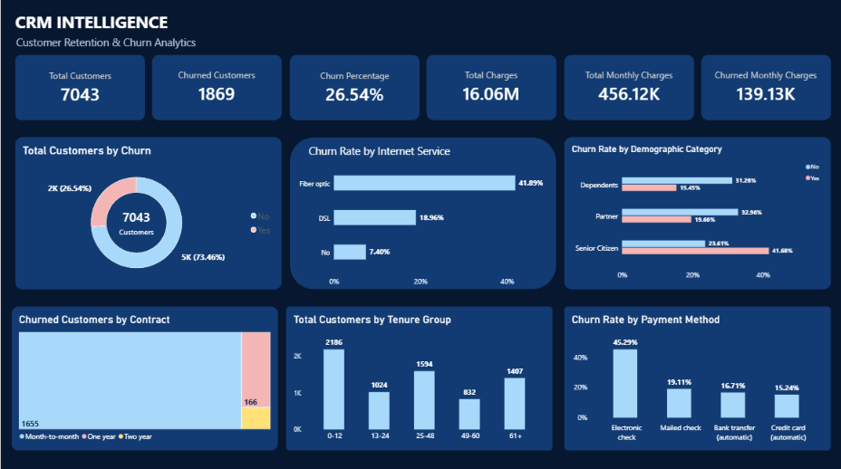
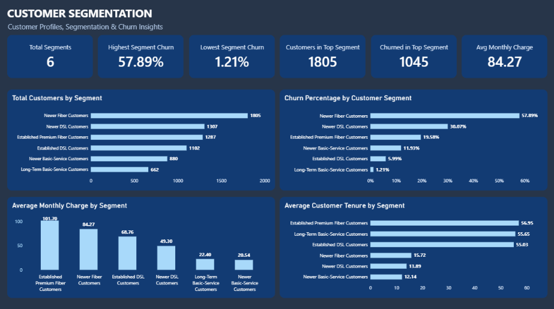
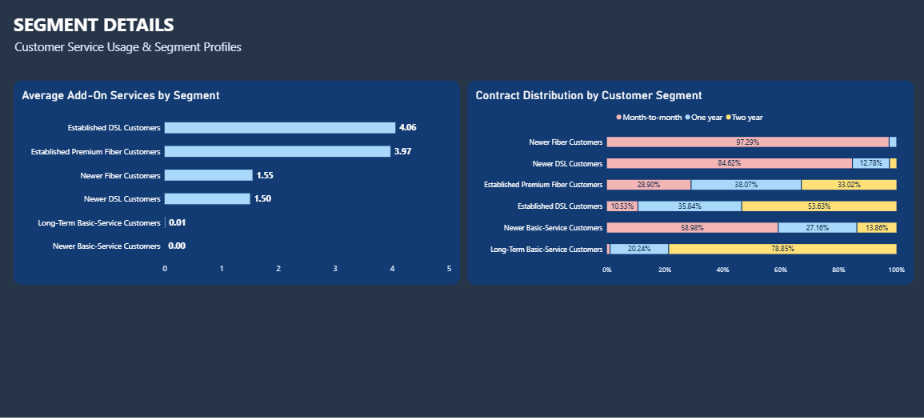

# CRM Intelligence — Customer Retention & Churn Analytics

**An end-to-end customer analytics portfolio project using Python, SQL, Power BI, K-Means Clustering, and Machine Learning.**

## Project Overview

This project analyzes customer behavior, identifies churn patterns, segments customers based on their service characteristics, and develops machine learning models for customer churn classification.

Using the IBM Telco Customer Churn dataset containing **7,043 customer records**, the project combines data preprocessing, relational SQL analysis, business intelligence dashboards, unsupervised learning, and supervised classification.

The primary objectives are to:

- Analyze customer churn across contracts, tenure, internet services, and billing characteristics.
- Identify customer groups with different behaviors and churn rates.
- Communicate findings through interactive Power BI dashboards.
- Develop and evaluate predictive churn models.
- Explore how predictive models could support customer retention decisions.

## Technologies Used

| Category | Technologies |
|---|---|
| Programming | Python |
| Data Processing | Pandas, NumPy |
| Database | SQLite, SQL |
| Visualization | Power BI, DAX |
| Machine Learning | Scikit-learn |
| Algorithms | K-Means, Logistic Regression, Random Forest |
| Model Storage | Joblib |
| Development | VS Code, Google Colab |

## Dataset

**Dataset:** IBM Telco Customer Churn

The dataset contains 7,043 customer records and 21 original columns covering demographics, subscribed services, contracts, payment methods, charges, and churn status.

### Data Preparation

- Inspected data types, missing values, and customer records.
- Converted `TotalCharges` into a numerical field.
- Replaced 11 missing `TotalCharges` values for customers with zero tenure with 0, documenting the assumption using an imputation flag.
- Prepared cleaned datasets for SQL analysis, visualization, and machine learning.
- Created customer-level segmentation and churn prediction outputs.

The source dataset is a fictional sample. Results are intended for analytical demonstration rather than claims about a real telecom company.

## SQL — Customer and Churn Analysis

Built an SQLite database containing four related tables:

- Customers
- Services
- Contracts
- Billing

Used SQL queries to investigate customer churn across business dimensions, including contract type, tenure, internet service, and monthly charges.

### Key Business Findings

| KPI | Result |
|---|---:|
| Total Customers | 7,043 |
| Churned Customers | 1,869 |
| Overall Churn Rate | 26.54% |
| Non-Churned Customers | 5,174 |
| Average Monthly Charges | 64.76 |

### Selected Insights

**Contract Type**

- Month-to-month customers: 42.71% churn.
- One-year contract customers: 11.27% churn.
- Two-year contract customers: 2.83% churn.

**Customer Tenure**

- Customers with 0–12 months of tenure: 47.44% churn.
- Customers with 49 or more months of tenure: 9.51% churn.

**Internet Service**

- Fiber optic: 41.89% churn.
- DSL: 18.96% churn.
- No internet service: 7.40% churn.

These findings describe associations in the sample, not causal relationships.

## Power BI Dashboards

Developed a three-page Power BI report for exploring customer churn and segmentation.

### Page 1 — CRM Overview

Includes customer KPIs, churn distribution, churn rates by service and payment method, demographic comparisons, contract analysis, and tenure distribution.



### Page 2 — Customer Segmentation

Visualizes customer counts, observed churn rates, average monthly charges, and average tenure across six K-Means segments.



### Page 3 — Segment Details

Explores average add-on service usage and contract composition across the customer segments.



Power BI report: `powerbi/CRM_Intelligence.pbix`

## Customer Segmentation — K-Means

Developed an unsupervised customer segmentation model using:

- Tenure
- Monthly charges
- Number of subscribed add-on services
- Internet service
- Contract type

Applied feature preprocessing and evaluated cluster counts using silhouette scores.

Selected **K = 6** for the final segmentation model.

### Identified Customer Segments

| Segment | Customers | Observed Churn Rate |
|---|---:|---:|
| Newer Fiber Customers | 1,805 | 57.89% |
| Newer DSL Customers | 1,307 | 30.07% |
| Established Premium Fiber Customers | 1,287 | 19.58% |
| Newer Basic-Service Customers | 880 | 11.93% |
| Established DSL Customers | 1,102 | 5.99% |
| Long-Term Basic-Service Customers | 662 | 1.21% |

The segmentation results help describe customer groups with different service usage, tenure, and churn characteristics.

Churn labels were not used as inputs when fitting K-Means.

## Machine Learning — Churn Prediction

Built and compared two supervised classification models:

- Logistic Regression
- Random Forest Classifier

Used an 80/20 stratified train-test split, categorical encoding, appropriate feature scaling, and five-fold cross-validation.

### Initial Model Comparison

| Metric | Logistic Regression | Random Forest |
|---|---:|---:|
| Accuracy | 79.77% | 79.21% |
| Precision | 64.40% | 63.02% |
| Recall | 53.21% | 52.41% |
| F1-score | 0.5827 | 0.5723 |
| ROC-AUC | 0.8362 | 0.8266 |

Logistic Regression was retained as the preferred proof-of-concept model based on its slightly stronger performance and simpler interpretation.

### Threshold Optimization

Explored classification thresholds using out-of-fold training predictions.

A threshold of **0.30** was selected for a recall-focused use case.

**Held-out test results at threshold 0.30:**

| Metric | Result |
|---|---:|
| Accuracy | 74.59% |
| Precision | 51.47% |
| Recall | 75.13% |
| F1-score | 0.6109 |
| F2-score | 0.6881 |
| ROC-AUC | 0.8362 |

At this threshold, the model correctly identified 281 of 374 churned customers in the test set, while generating 265 false-positive predictions.

The lower threshold improved recall but increased false alerts. The model should therefore be considered a **proof of concept**, not a production-ready customer retention system.

### Model Outputs

Saved the trained Logistic Regression pipeline and decision threshold using Joblib.

Generated a customer-level prediction file containing:

- Customer ID
- Predicted churn probability
- Predicted churn classification
- Actual churn label

The full-dataset scoring output contains both training and test records and must not be used as an independent performance evaluation.

## Project Structure

```text
crm-intelligence/
├── data/
│   ├── raw/
│   └── processed/
├── database/
│   └── crm.db
├── models/
│   ├── crm_segmentation_model.joblib
│   └── crm_churn_model.joblib
├── powerbi/
│   └── CRM_Intelligence.pbix
├── reports/
│   └── screenshots/
├── sql/
├── src/
├── .gitignore
├── requirements.txt
└── README.md
```

## Getting Started

Clone the repository and install Python dependencies:

```bash
pip install -r requirements.txt
```

Run the saved churn prediction model on sample customers:

```bash
python src/test_churn_model.py
```

Generate customer-level churn predictions:

```bash
python src/score_all_customers.py
```

Reproduce customer segmentation using the saved segmentation pipeline:

```bash
python src/segment_customers.py
```

The saved models require compatible Python and scikit-learn environments.

Model experimentation and training were performed in Google Colab. The trained model artifacts and local scoring scripts are included; full training notebooks are not included at this stage.

Open `powerbi/CRM_Intelligence.pbix` in Power BI Desktop to explore the dashboards.

## Project Limitations

- The dataset is a fictional customer sample without a historical event timeline.
- Churn relationships are descriptive and should not be interpreted as causal.
- The ML evaluation uses a random train-test split rather than a future time-based validation.
- Classification produces false positives and false negatives.
- Probability calibration and operational retention costs have not been fully evaluated.
- Real-world deployment would require new customer data, temporal validation, monitoring, and further testing.

## Conclusion

This project demonstrates an end-to-end analytical workflow, from data cleaning and relational SQL analysis to business intelligence reporting, customer segmentation, and supervised churn classification.

It highlights how customer analytics can support business understanding while emphasizing transparent model evaluation and responsible interpretation of predictions.
